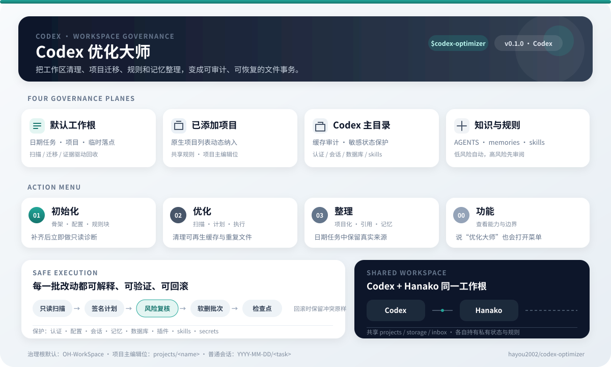

# codex-optimizer · Codex 优化大师



把工作区治理变成可审计、可恢复的 Codex 文件事务。它治理默认工作根、日期任务目录、Codex 已添加项目、Codex 主目录、规则、技能、自动化和生成记忆。它还提供 Codex 与 Hanako 在同一个根目录下协作的租约、交接和检查点协议。

本项目是 [hana-optimizer](https://github.com/hayou2002/hana-optimizer) 的独立 Codex 适配版，吸收了上游 PR #1 的环境对位、实例痕迹清理和悬空引用修复。它作为独立项目维护，不是原仓库的自动镜像。

## 它解决什么

- 普通会话继续使用 Codex 生成的 `YYYY-MM-DD/<任务>` 目录。
- 明确或持续的项目进入 `projects/<name>`，成为唯一主编辑位。
- 只有实际在用和可交付的文件进入项目，日期目录保留历史来源。
- Codex 主目录中可证明可再生的缓存可回收；认证、会话、数据库、插件和技能正文受到保护。
- 清理和迁移先生成完整计划，再执行可回滚事务，并写检查点。

## 安装

从源码安装：

```powershell
$source = "$env:USERPROFILE\Desktop\OH-WorkSpace\projects\codex-optimizer"
$target = Join-Path $env:USERPROFILE ".codex\skills\codex-optimizer"
New-Item -ItemType Directory -Force -Path $target | Out-Null
Copy-Item -Path (Join-Path $source "*") -Destination $target -Recurse -Force
```

Codex 会自动发现新 skill；如果界面尚未刷新，重启 Codex。

显式调用：

```text
$codex-optimizer
```

或说“优化大师”。

## 动作菜单

```text
01 初始化
02 优化
03 整理
00 功能
```

初始化会创建混合目录骨架、补齐 `codex-rules.json`、预览并注入 `AGENTS.md` 标记块，再核对骨架、规则和注入结果后结束。它不会自动追加全量诊断、创建定时任务或立即清理。

## 快速建立项目

已经知道源目录或 Git URL 时，不需要先扫描全工作区、生成计划或申请租约：

```powershell
$cli = "$env:USERPROFILE\.codex\skills\codex-optimizer\scripts\codex_optimizer.py"
$root = "$env:USERPROFILE\Desktop\OH-WorkSpace"

# 复制本地项目，保留来源
python $cli quick-project --root $root `
  --source "D:\work\example" --slug "example"

# 或克隆远端项目
python $cli quick-project --root $root `
  --git-url "https://github.com/example/project.git" --slug "example"
```

默认保留来源，补齐 `README.md` 和 `source.md`，做一次目标核验后结束。只有共享、持续协作或复杂项目确有需要时才补项目 `AGENTS.md`。目标已存在就停止，不覆盖。仅当用户明确要求搬走本地来源时加 `--move`。

安全清理仍使用完整计划与回滚；普通复制只核大小和修改时间，不另做逐文件 SHA256 与第二份备份。计划阶段也不预计算执行时不会使用的 SHA256。租约只在发现活跃并发或实际交接时使用。

## 整理盘点

`03` 先运行一次只读盘点：

```powershell
python $cli organize-scan --root $root
```

结果包含根级散件、保留名和运行时线索、项目入口文件状态、项目过程数据提示，
以及“明确可归位 / 需隔离 / 保留或只报告”三档分类。项目文档只给仍有维护
价值的项目补，不为全部历史项目批量生成。浏览器 profile、登录数据和运行数据库
需分组进入可回滚的高风险恢复区。

盘点只读且默认有预算：项目根和常见过程目录最多检查 4 层、400 个条目，
结果会标出 `truncated`，只作为定位线索，不对深层历史做完整审计。

路径没有变化时不执行记忆、经验、Git 和配置的固定十步同步；只有旧路径被引用，
或项目身份、仓库、挂载关系变化时，才查找并更新相应位置。

### 归档旧恢复批次

当多个旧批次已经在恢复区、每个批次自带 `.manifest.jsonl`，只是转存到另一个恢复位置：

```powershell
python $cli archive-batch --root $root --source-dir "$root\_temp\反悔区"
```

命令会整体预检并逐批移动，保留原 manifest，写一份索引和事务，然后验证一次。
路径、编码或结构不合格的批次会进入 `skipped`，不会触发整批重跑。不要为这个
场景临时写 Python 脚本、运行编译，或给每个批次补第二套事务。

只处理指定批次时重复传入 `--name`：

```powershell
python $cli archive-batch --root $root `
  --source-dir "$root\_temp\反悔区" --name "20261008"
```

## 目录模型

```text
OH-WorkSpace\
├── projects\
├── storage\
│   ├── docs\
│   ├── backups\
│   └── tools\
├── inbox\
├── _temp\
│   ├── screenshots\
│   ├── data\
│   ├── scratch\
│   ├── exports\
│   ├── jobs\
│   ├── checkpoints\
│   ├── trash\
│   └── plans\
├── .optimize\
│   ├── codex-rules.json
│   ├── rules.json
│   └── COLLABORATION.md
└── YYYY-MM-DD\
    └── <Codex 生成的任务目录>
```

默认根可以自定义。切换根时先创建新根骨架，检查冲突与空间，再复制、校验并软删旧内容。

## Codex + Hanako 协作

两套 Agent 共用 `projects/`、`storage/`、`inbox/`、生命周期明确的 `_temp/` 内容和共享根 `AGENTS.md`，但各自保留安装、认证、会话、数据库、私密记忆、skills、automations 和规则文件。

发现活跃并发、需要接管租约或交接时，先读取 `.optimize/COLLABORATION.md`：

```powershell
$cli = "$env:USERPROFILE\.codex\skills\codex-optimizer\scripts\codex_optimizer.py"
$root = "$env:USERPROFILE\Desktop\OH-WorkSpace"
$project = "$root\projects\example"
python $cli collaborate --root $root status --target $project
python $cli collaborate --root $root claim --target $project --agent codex --purpose "fix tests"
python $cli collaborate --root $root release --target $project --agent codex
```

单 Agent 的普通编辑不创建租约。租约默认 30 分钟过期，只协调共享路径，不代表文件所有权。`handoff` 只记录实际交接，不代用户发送消息。

## 检查预算

所有动作共用一条验收线：产物一处完整性、目标一处回读、行为一次验收。同一事实
只验一次，已通过项不重复验。哈希只用于跨盘后删源、同名内容冲突和发布包完整性，
不跨源目录、项目副本和本机安装副本反复比对。命令失败先读报错并修正一次；
发布命令同类失败也只修正一次。成功标准满足后直接交付。

## 与 hana-optimizer 隔离

- 本项目的现场规则文件是 `.optimize/codex-rules.json`。
- Hanako 使用 `.optimize/rules.json` 时，本 skill 不读取也不覆盖它。
- 本 skill 不修改 `~/.hanako/skills/hana-optimizer`。
- 两套 Agent 可以有各自的安装和规则；README 和根 `AGENTS.md` 标记块用于避免规则互相误覆盖。

## CLI

```powershell
$cli = "$env:USERPROFILE\.codex\skills\codex-optimizer\scripts\codex_optimizer.py"
python $cli diagnose --help
python $cli apply --help
python $cli rollback --help
```

只读诊断：

```powershell
python $cli diagnose --root "$env:USERPROFILE\Desktop\OH-WorkSpace"
```

默认扫描使用文件与目录预算，会把未完整扫描的外部项目和 Codex 主目录标为
`truncated`；需要完整元数据审计时显式加 `--deep`。只读诊断不会写入报告。

生成报告和计划：

```powershell
python $cli diagnose --root "$env:USERPROFILE\Desktop\OH-WorkSpace" --json --plan
```

加入 Codex 已添加项目时，重复传入：

```powershell
python $cli diagnose --root "$env:USERPROFILE\Desktop\OH-WorkSpace" `
  --project-root "D:\AI\Prima" `
  --project-root "D:\AI\NewApi管理"
```

`apply` 默认只 dry-run；执行计划必须显式传入 `--execute`：

```powershell
python $cli apply --plan "<plan.json>" --root "$env:USERPROFILE\Desktop\OH-WorkSpace" --execute
```

按批次回滚：

```powershell
python $cli rollback --root "$env:USERPROFILE\Desktop\OH-WorkSpace" --batch-id "<batch-id>"
```

## 安全边界

- 诊断默认零写入。
- 缓存必须有重建证据；唯一源、运行态、凭据和被引用文件不因超龄自动删除。
- 所有删除先进入 `_temp/trash/<batch>`，JSONL manifest 记录源、目标、大小和修改时间；跨盘复制后删源、同名冲突和发布完整性才计算 SHA256。
- 安全回收项保留 14 天；高风险项不会自动清空。
- 回收区存在带 `transaction.json` 的完整批次时，可在到期后运行 `purge`；默认仍为 dry-run。
- 已有自管 manifest 的旧批次可用 `archive-batch` 一次性软归档；坏批次跳过并写入事务，不拦截其余批次。
- 批量失败自动恢复本次已执行步骤。
- 路径、符号链接和治理边界在执行前重新验证。

详细规则见 `references/`。

## 测试

```powershell
python -m unittest discover -s tests -v
python "$env:USERPROFILE\.codex\skills\.system\skill-creator\scripts\quick_validate.py" .
```

测试全部使用标准库和临时目录，不接触真实工作区。Windows 默认代码页与 UTF-8
中文 `SKILL.md` 不兼容时，项目测试会对 `skill-creator` 的校验函数显式使用
UTF-8 读取；直接运行上游脚本时请先设置 `PYTHONUTF8=1`。

## 更新与回滚

从项目源更新：

```powershell
Set-Location "$env:USERPROFILE\Desktop\OH-WorkSpace\projects\codex-optimizer"
git pull --ff-only
python -m unittest discover -s tests -v
```

测试通过后重新执行“安装”中的复制步骤。计划、回收与回滚数据位于默认根的 `_temp/`。

## 发布包

构建只含运行文件的 skill 包及 SHA256：

```powershell
python scripts/build_release.py
```

输出为 `dist/codex-optimizer.skill.zip` 和对应 `.sha256` 文件。发行包不放测试、
项目记录或本地安装副本。

## 许可

MIT © 2026 hayou2002

